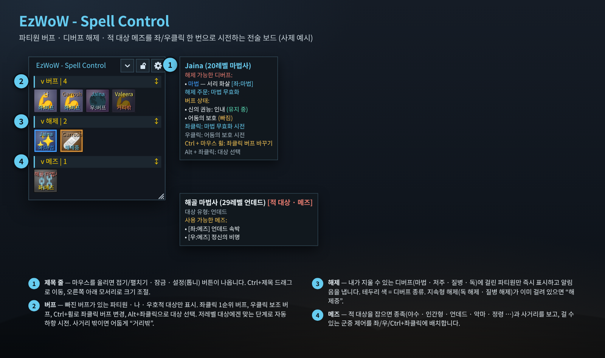
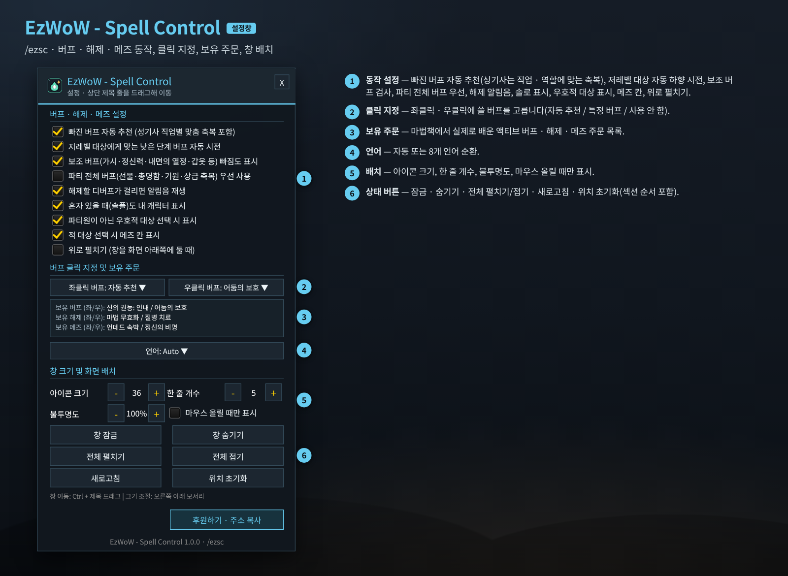
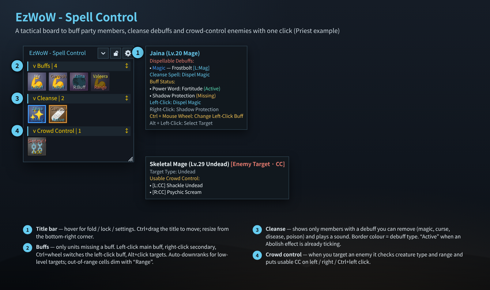
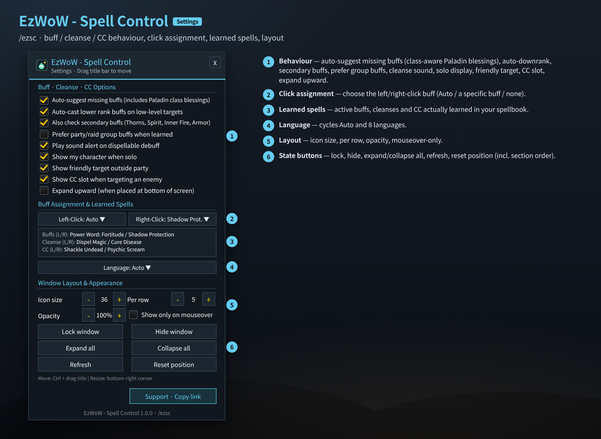

# EzWoW - Spell Control (`EzWoW-SpellControl`)

## CurseForge

- **Project ID / 프로젝트 ID:** `1755568`
- **Project page / 프로젝트 페이지:** [EzWoW-SpellControl](https://www.curseforge.com/wow/addons/ezwow-spell-control)

**[한국어](#한국어) · [English](#english)**

WoW Forever (`Interface: 16001`) · `/ezsc`

---

## 한국어

### 개요

파티·공격대에서 **빠진 버프 걸기 · 디버프 해제 · 적 대상 메즈(군중 제어)**를 마우스 클릭 한 번으로 하게 해 주는 작은 전술 보드입니다. 내 캐릭터가 마법책에서 **실제로 배운 액티브 주문만** 읽어서 `버프` / `해제` / `메즈` 세 칸에 필요한 대상만 보여 줍니다.

### 화면 미리보기

> 이미지는 애드온 코드의 창 크기·좌표·색상·문구로 재현한 **예시 화면**(사제 예시)입니다. 파티원 이름은 예시입니다.

### 설치

1. `EzWoW-SpellControl` 폴더를 `Interface/AddOns/` 폴더에 넣습니다.
2. 캐릭터 선택 화면의 **애드온** 목록에서 켭니다.
3. 접속하면 전술 보드가 나타납니다. 설정은 `/ezsc` 또는 보드 제목 줄의 톱니바퀴.

### 사용법 (위 그림의 번호)

| 번호 | 부분 | 설명 |
|---|---|---|
| ① | 제목 줄 | 마우스를 올리면 **접기/펼치기 · 잠금/해제 · 설정(톱니바퀴)** 버튼이 나타납니다. **Ctrl + 제목 좌클릭 드래그**로 언제든 이동하고, 오른쪽 아래 모서리로 크기를 바꿉니다. 잠금을 풀면 섹션 제목을 위·아래로 끌어 **섹션 순서**를 바꿀 수 있습니다. |
| ② | 버프 | 버프가 빠진 파티·공격대원, 나(솔로 표시 옵션), 파티 밖 우호적 대상만 보입니다. 칸 위쪽은 이름, 아래쪽은 배지입니다. |
| ③ | 해제 | 내가 지울 수 있는 디버프(마법 · 저주 · 질병 · 독)에 걸린 파티원만 바로 나타나고 알림음이 울립니다. 테두리 색이 디버프 종류입니다. 독 해제·질병 해제 같은 **지속형 해제가 이미 걸려 있으면 `해제중`**으로 표시해 마나 낭비를 막습니다. |
| ④ | 메즈 | 적을 대상으로 잡으면 **생명체 유형**(야수 · 인간형 · 언데드 · 악마 · 정령 · 용족 · 거인 · 기계)과 사거리를 확인해, 걸 수 있는 군중 제어 주문(변이, 언데드 속박, 겨울잠, 추방, 현혹, 실명, 비열한 습격/급소 가격, 얼음의 덫, 공포 등)을 칸에 배치합니다. |

#### 클릭 조작

| 칸 | 좌클릭 | 우클릭 | 그 밖 |
|---|---|---|---|
| 버프 | 1순위 버프 (`좌:버프`) | 보조 버프 (`우:버프`, 가시 · 천상의 정신 · 내면의 열정 · 마법사 갑옷 등) | **Ctrl + 휠**: 좌클릭 버프 바꾸기 · **Alt + 좌클릭**: 대상 선택 |
| 해제 | 주력 해제 (`좌:마법`, `좌:저주` …) | 보조 해제 (`우:독`, `우:질병` …) | Alt + 좌클릭: 대상 선택 |
| 메즈 | 1순위 메즈 (`좌:메즈`) | 2순위 메즈 (`우:메즈`) | **Ctrl + 좌클릭**: 3순위 메즈 (`C좌:메즈`) |

배지 뜻: `거리밖` 사거리 밖 · `완료` 버프 유지 중 · `오프` 오프라인 · `사망` 죽음/유령 · `불가` 걸 수 있는 메즈 없음 · `대기` 대상 대기

#### 똑똑한 버프 고르기

- **직업별 맞춤**: 나에게만 거는 버프(내면의 열정, 얼음 갑옷, 정의의 격노, 번개 보호막, 악마의 갑옷 등)는 내 칸에서만 검사합니다. 마나가 없는 직업(전사·도적)에게는 지능·정신력·지혜의 축복을 권하지 않습니다. 성기사는 대상의 역할·직업에 맞춰 힘 · 지혜 · 구원의 축복을 고릅니다.
- **저레벨 대상 자동 하향**: 저레벨 파티원에게는 그 레벨이 받을 수 있는 가장 높은 단계(`주문이름(X 레벨)`)를 자동으로 계산해 겁니다.
- **단체 버프 우선**: 야생의 선물, 신비한 총명함, 천상의 기원, 상급 축복 등을 배웠다면 먼저 쓰도록 할 수 있습니다.

### 설정창 (`/ezsc`)

| 번호 | 항목 | 기본값 |
|---|---|---|
| ① | 빠진 버프 자동 추천 (성기사 직업별 맞춤 축복 포함) | 켬 |
| ① | 저레벨 대상에게 맞는 낮은 단계 버프 자동 시전 | 켬 |
| ① | 보조 버프(가시·정신력·내면의 열정·갑옷 등) 빠짐도 표시 | 켬 |
| ① | 파티 전체 버프(선물·총명함·기원·상급 축복) 우선 사용 | 끔 |
| ① | 해제할 디버프가 걸리면 알림음 재생 | 켬 |
| ① | 혼자 있을 때(솔플)도 내 캐릭터 표시 | 켬 |
| ① | 파티원이 아닌 우호적 대상 선택 시 표시 | 켬 |
| ① | 적 대상 선택 시 메즈 칸 표시 | 켬 |
| ① | 위로 펼치기 (창을 화면 아래쪽에 둘 때) | 끔 |
| ② | 좌클릭 버프 / 우클릭 버프: 자동 추천 · 특정 버프 · 사용 안 함 | 자동 추천 |
| ③ | 보유 버프 · 보유 해제 · 보유 메즈 (좌/우) 목록 | - |
| ④ | 언어 (자동 + 8개 언어 순환) | 자동 |
| ⑤ | 아이콘 크기 · 한 줄 개수 · 불투명도 · 마우스 올릴 때만 표시 | 36 · 5 · 100% · 끔 |
| ⑥ | 창 잠금 · 창 숨기기 · 전체 펼치기 · 전체 접기 · 새로고침 · 위치 초기화 | - |
| | 후원하기 · 주소 복사 | - |

### 명령어 (`/ezsc`, `/spellcontrol`, `/스펠컨트롤`, `/ezbc`, `/버프해제`)

| 명령어 | 설명 |
|---|---|
| `/ezsc` | 설정창 열기/닫기 |
| `/ezsc toggle` (`board`) | 전술 보드 표시/숨기기 |
| `/ezsc lock` | 보드 잠금/해제 |
| `/ezsc reset` | 보드 위치·크기와 섹션 순서 초기화 (전투 중이 아닐 때) |

### 저장 데이터

- `EzWoW_SpellControlDB`: 설정, 보드 위치·크기, 섹션 순서·접힘, 직업별 좌/우클릭 버프 선택.

### 알아두면 좋은 점

- 보안 주문 버튼을 쓰기 때문에 **전투 중에는 칸 구성이 바뀌지 않습니다**. 전투가 끝나면 자동으로 다시 정리됩니다.
- 패시브 주문은 읽지 않습니다. 새 주문을 배웠는데 안 보이면 **새로고침**을 누르세요.

---

## English

### Overview

A small tactical board that lets you **buff missing members, cleanse debuffs and crowd-control enemies** with a single click. It reads only **active spells you have actually learned** and shows just the units that need something in three sections: `Buffs` / `Cleanse` / `Crowd Control`.

### Screenshots

> These are **mock-ups** (Priest example) rebuilt from the window sizes, coordinates, colours and strings in the code. Party names are examples.

### Installation

1. Copy the `EzWoW-SpellControl` folder into `Interface/AddOns/`.
2. Enable it in the **AddOns** list on the character select screen.
3. The board appears after login. Settings: `/ezsc` or the gear on the board's title bar.

### How to use (numbers in the picture)

| No. | Part | Description |
|---|---|---|
| ① | Title bar | Hover for **fold/unfold · lock/unlock · settings (gear)**. **Ctrl + left-drag the title** moves it any time; resize from the bottom-right corner. While unlocked, drag section headers up/down to **reorder sections**. |
| ② | Buffs | Only party/raid members missing a buff, yourself (solo option) and a friendly non-party target. Name on top of the cell, badge at the bottom. |
| ③ | Cleanse | Members with a debuff you can remove (magic, curse, disease, poison) appear at once with a sound. Border colour = debuff type. If a periodic cleanse (Abolish Poison/Disease) is already running, the cell shows **`Active`** to save mana. |
| ④ | Crowd control | When you target an enemy it checks **creature type** (beast, humanoid, undead, demon, elemental, dragonkin, giant, mechanical) and range, and places usable CC (Polymorph, Shackle Undead, Hibernate, Banish, Seduction, Blind, Sap/Gouge, Freezing Trap, Fear, …). |

#### Click controls

| Cell | Left-click | Right-click | Other |
|---|---|---|---|
| Buff | Main buff (`L:Buff`) | Secondary buff (`R:Buff`: Thorns, Divine Spirit, Inner Fire, Mage Armor, …) | **Ctrl + wheel**: change the left-click buff · **Alt + left-click**: target |
| Cleanse | Main cleanse (`L:Mag`, `L:Cur` …) | Secondary cleanse (`R:Poi`, `R:Dis` …) | Alt + left-click: target |
| CC | 1st CC (`L:CC`) | 2nd CC (`R:CC`) | **Ctrl + left-click**: 3rd CC |

Badges: `Range` out of range · `OK` buff active · offline · dead/ghost · no usable CC · waiting for target

#### Smart buff choice

- **Class-aware**: self-only buffs (Inner Fire, Ice Armor, Righteous Fury, Lightning Shield, Demon Armor, …) are checked on your own cell only. Intellect, Spirit and Blessing of Wisdom are not suggested for warriors and rogues. Paladins get Might, Wisdom or Salvation matched to the target's role and class.
- **Auto-downranking**: for low-level members the highest rank they can receive (`Spell (Rank X)`) is calculated and cast.
- **Prefer group buffs**: optionally use Gift of the Wild, Arcane Brilliance, Prayer of Fortitude, Greater Blessings, … first when learned.

### Settings window (`/ezsc`)

| No. | Option | Default |
|---|---|---|
| ① | Auto-suggest missing buffs (includes Paladin class blessings) | On |
| ① | Auto-cast lower rank buffs on low-level targets | On |
| ① | Also check secondary buffs (Thorns, Spirit, Inner Fire, Armor) | On |
| ① | Prefer party/raid group buffs when learned | Off |
| ① | Play sound alert on dispellable debuff | On |
| ① | Show my character when solo | On |
| ① | Show friendly target outside party | On |
| ① | Show CC slot when targeting an enemy | On |
| ① | Expand upward (when placed at bottom of screen) | Off |
| ② | Left-Click / Right-Click buff: Auto · a specific buff · none | Auto |
| ③ | Learned buffs · cleanses · CC (L/R) | - |
| ④ | Language (cycles Auto + 8 languages) | Auto |
| ⑤ | Icon size · Per row · Opacity · Show only on mouseover | 36 · 5 · 100% · Off |
| ⑥ | Lock window · Hide window · Expand all · Collapse all · Refresh · Reset position | - |
| | Support · Copy link | - |

### Slash commands (`/ezsc`, `/spellcontrol`, `/스펠컨트롤`, `/ezbc`, `/버프해제`)

| Command | Description |
|---|---|
| `/ezsc` | Open/close settings |
| `/ezsc toggle` (`board`) | Show/hide the board |
| `/ezsc lock` | Lock/unlock the board |
| `/ezsc reset` | Reset board position, size and section order (out of combat) |

### Saved data

- `EzWoW_SpellControlDB`: settings, board position/size, section order and collapsed state, per-class left/right-click buffs.

### Tips

- The board uses secure spell buttons, so **its cells cannot change during combat**; it refreshes when combat ends.
- Passive spells are ignored. If a newly learned spell does not appear, press **Refresh**.

---

## Support / 후원

If you find this addon useful, you can support its development.

애드온이 도움이 되셨다면 개발 후원으로 응원해 주세요.

[Buy Me a Coffee ☕](https://buymeacoffee.com/qqhrqqhr2)
