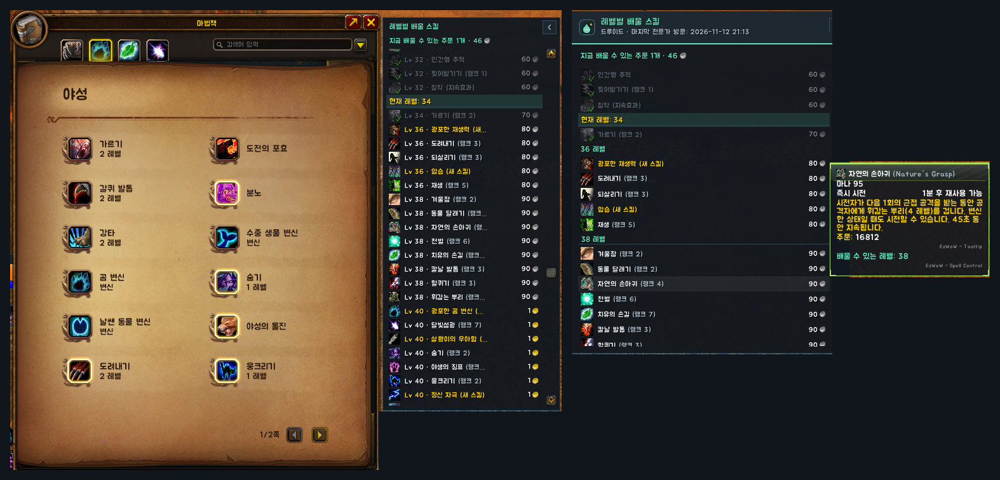
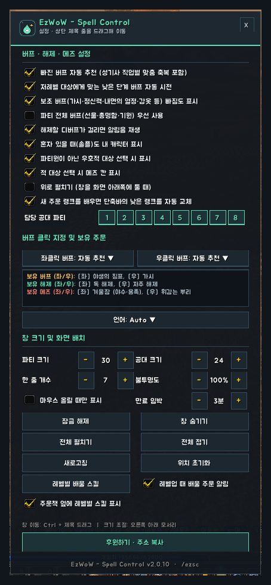
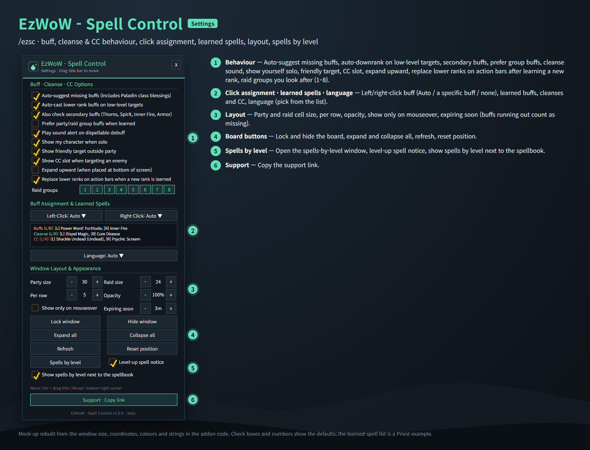

# EzWoW - Spell Control (`EzWoW-SpellControl`)

## CurseForge

- **Project ID / 프로젝트 ID:** `1755568`
- **Project page / 프로젝트 페이지:** [EzWoW-SpellControl](https://www.curseforge.com/wow/addons/ezwow-spell-control)

**[한국어](#한국어) · [English](#english)**

WoW Forever (`Interface: 16001`) · `/ezsc`

---

## 한국어

### 개요

파티 · 공격대에서 **빠진 버프 걸기 · 디버프 해제 · 적 대상 메즈(군중 제어)**를 마우스 클릭 한 번으로 하게 해 주는 작은 전술 보드입니다. 내 캐릭터가 마법책에서 **실제로 배운 액티브 주문만** 읽어서 `버프` / `해제` / `메즈` 세 칸에 필요한 대상만 보여 줍니다.

직업 기술 전문가를 한 번 열면 **레벨별로 배울 주문과 비용**을 저장해 두고, 별도 창(`/ezsc spells`) · 주문책 옆 패널 · 주문 툴팁 · 레벨업 알림으로 알려 줍니다.

특성 창에는 **추천 특성** 단추가 붙습니다. 직업별 추천 빌드를 고르면 남은 특성 포인트를 빌드 순서대로 넣어 줍니다(`/추천특성`).

### 화면 미리보기

> 실제 게임 화면입니다(WoW Forever, 한국어 클라이언트). 캐릭터 · 다른 플레이어 이름과 채팅 내용은 가렸습니다.

### 설치

1. `EzWoW-SpellControl` 폴더를 `Interface/AddOns/` 폴더에 넣습니다.
2. 캐릭터 선택 화면의 **애드온** 목록에서 켭니다.
3. 접속하면 전술 보드가 나타납니다. 설정은 `/ezsc` 또는 보드 제목 줄의 톱니바퀴.

### 사용법

| 번호 | 부분 | 설명 |
|---|---|---|
| ① | 제목 줄 | 마우스를 올리면 **접기/펼치기 · 잠금/해제 · 설정(톱니바퀴)** 버튼이 나타납니다. **Ctrl + 제목 좌클릭 드래그**로 언제든 이동하고, 오른쪽 아래 모서리로 크기를 바꿉니다. 잠금을 풀면 섹션 제목을 위 · 아래로 끌어 **섹션 순서**를 바꿀 수 있습니다. |
| ② | 버프 | 버프가 빠진 파티 · 공격대원, 나(솔로 표시 옵션), 파티 밖 우호적 대상만 보입니다. 칸 위쪽은 이름, 아래쪽은 배지입니다. 공격대에서는 **담당 공대 파티**로 고른 파티만 나오고 파티마다 새 줄에서 시작합니다. |
| ② | 해제 | 내가 지울 수 있는 디버프(마법 · 저주 · 질병 · 독)에 걸린 파티원만 바로 나타나고 알림음이 울립니다. 테두리 색이 디버프 종류입니다. 독 해제 · 질병 해제 같은 **지속형 해제가 이미 걸려 있으면 `해제중`**으로 표시해 마나 낭비를 막습니다. |
| ② | 메즈 | 적을 대상으로 잡으면 **생명체 유형**(야수 · 인간형 · 언데드 · 악마 · 정령 · 용족 · 거인 · 기계)과 사거리를 확인해, 걸 수 있는 군중 제어 주문(변이, 언데드 속박, 겨울잠, 추방, 현혹, 실명, 비열한 습격/급소 가격, 얼음의 덫, 공포 등)을 칸에 배치합니다. |
| ③ | 주문 툴팁 랭크 안내 | 배운 주문의 툴팁에 **다음 랭크: 랭크 N · Lv**, 아직 배우지 않은 랭크의 툴팁에 **배울 수 있는 레벨: N**이 붙습니다. |
| ④ | 레벨별 배울 스킬 (`/ezsc spells`) | 직업 기술 전문가 창을 열 때 저장한 목록을 모든 레벨에 걸쳐 보여 주고, **현재 레벨** 줄에서 열립니다. **지금 배울 수 있는 주문**은 강조색, 처음 배우는 주문은 노란 **(새 스킬)**, 나머지는 **(랭크 N)**, 이미 배운 주문은 흐리게 체크 표시, 오른쪽은 비용입니다. 위쪽에 지금 배울 수 있는 주문 수와 합계 비용, 제목 아래에 마지막 전문가 방문 시각이 나옵니다. |
| ⑤ | 주문책 옆 패널 | 주문책을 열면 같은 목록이 주문책 오른쪽에 붙습니다(줄마다 `Lv`). `<` 단추로 접고 `>`로 다시 펼칩니다. |
| ⑥ | 레벨업 알림 | 레벨이 오르면 새로 배울 수 있는 주문 수를 채팅창에 알려 줍니다(전투 중이면 전투가 끝난 뒤). |
| ⑦ | 추천 특성 (`/추천특성`) | 특성 창 검색창 왼쪽의 **추천 특성** 단추를 누르면 내 직업의 빌드 목록(`전문화 (역할)  분배`)이 나옵니다. 하나를 고르면 남은 포인트를 넣고, **적용할지 한 번 더 묻습니다**. |

#### 클릭 조작

| 칸 | 좌클릭 | 우클릭 | 그 밖 |
|---|---|---|---|
| 버프 | 1순위 버프 (`좌:버프`) | 보조 버프 (`우:버프`, 가시 · 천상의 정신 · 내면의 열정 · 마법사 갑옷 등) | **Ctrl + 휠**: 좌클릭 버프 바꾸기 · **Alt + 좌클릭**: 대상 선택 |
| 해제 | 주력 해제 (`좌:마법`, `좌:저주` …) | 보조 해제 (`우:독`, `우:질병` …) | Alt + 좌클릭: 대상 선택 |
| 메즈 | 1순위 메즈 (`좌:메즈`) | 2순위 메즈 (`우:메즈`) | **Ctrl + 좌클릭**: 3순위 메즈 (`C좌:메즈`) |

배지 뜻: `거리밖` 사거리 밖 · `완료` 버프 유지 중 · `오프` 오프라인 · `사망` 죽음/유령 · `불가` 걸 수 있는 메즈 없음 · `대기` 대상 대기

#### 똑똑한 버프 고르기

- **직업별 맞춤**: 나에게만 거는 버프(내면의 열정, 얼음 갑옷, 정의의 격노, 번개 보호막, 악마의 갑옷 등)는 내 칸에서만 검사합니다. 마나가 없는 직업(전사 · 도적)에게는 지능 · 정신력 · 지혜의 축복을 권하지 않습니다. 성기사는 대상의 역할 · 직업에 맞춰 힘 · 지혜 · 왕의 축복을 고릅니다.
- **저레벨 대상 자동 하향**: 저레벨 파티원에게는 그 레벨이 받을 수 있는 가장 높은 단계(`주문이름(X 레벨)`)를 자동으로 계산해 겁니다.
- **단체 버프 우선**: 야생의 선물, 신비한 총명함, 천상의 기원 등을 배웠다면 먼저 쓰도록 할 수 있습니다.
- **만료 임박**: 남은 시간이 설정값(기본 3분)보다 짧은 버프는 빠진 것으로 보고 미리 다시 걸 수 있게 합니다.
- **랭크 자동 교체**: 새 랭크를 배우면 단축바에 있는 낮은 랭크를 새 랭크로 바꿉니다.
- **전투 중 버프 상태**: 전투 중에도 버프 칸은 버프가 다시 걸리면 바로 `완료`로 바뀌고, 풀리면 다시 빠진 상태로 보입니다.

#### 추천 특성

- 특성 창을 열면 검색창 왼쪽에 **추천 특성** 단추가 생깁니다. `/추천특성`(`/eztalent`)으로 어디서나 같은 메뉴를 열 수 있습니다.
- 메뉴에는 내 직업의 1~60레벨 빌드가 나옵니다(예: `암흑 (딜러)  16/3/32`). 전문화마다 하나씩, 직업마다 3개이고 드루이드는 4개(야성 딜러 · 탱커 따로)입니다.
- 빌드를 고르면 남은 포인트를 빌드 순서대로 넣은 뒤 **적용 / 취소**를 묻습니다. 취소하면 넣은 포인트를 되돌립니다.
- 레벨업 중에는 레벨이 오를 때마다 다시 누르면 이어서 찍습니다. 빌드에 없는 특성에 이미 포인트가 있으면 채팅창에 알려 줍니다.
- 전투 중에는 특성을 바꿀 수 없습니다.

### 설정창 (`/ezsc`)

| 번호 | 항목 | 기본값 |
|---|---|---|
| ① | 빠진 버프 자동 추천 (성기사 직업별 맞춤 축복 포함) | 켬 |
| ① | 저레벨 대상에게 맞는 낮은 단계 버프 자동 시전 | 켬 |
| ① | 보조 버프(가시 · 정신력 · 내면의 열정 · 갑옷 등) 빠짐도 표시 | 켬 |
| ① | 파티 전체 버프(선물 · 총명함 · 기원) 우선 사용 | 끔 |
| ① | 해제할 디버프가 걸리면 알림음 재생 | 켬 |
| ① | 혼자 있을 때(솔플)도 내 캐릭터 표시 · 파티원이 아닌 우호적 대상 표시 · 적 대상 메즈 칸 표시 | 켬 |
| ① | 위로 펼치기 (창을 화면 아래쪽에 둘 때) | 끔 |
| ① | 새 주문 랭크를 배우면 단축바의 낮은 랭크를 자동 교체 | 켬 |
| ① | 담당 공대 파티 1~8 (끈 파티는 공격대에서 칸이 생기지 않음) | 모두 켬 |
| ② | 좌클릭 버프 / 우클릭 버프: 자동 추천 · 특정 버프 · 사용 안 함 | 자동 추천 |
| ② | 보유 버프 · 보유 해제 · 보유 메즈 (좌/우) 목록 · 언어(목록에서 자동 + 8개 언어) | 자동 |
| ③ | 파티 크기 · 공대 크기 · 한 줄 개수 · 불투명도 | 30 · 24 · 5 · 100% |
| ③ | 마우스 올릴 때만 표시 · 만료 임박(0~10분, 0 = 끔) | 끔 · 3분 |
| ④ | 창 잠금 · 창 숨기기 · 전체 펼치기 · 전체 접기 · 새로고침 · 위치 초기화 | - |
| ⑤ | 레벨별 배울 스킬 창 · 레벨업 때 배울 주문 알림 · 주문책 옆에 레벨별 스킬 표시 | - · 켬 · 켬 |
| ⑥ | 후원하기 · 주소 복사 | - |

### 명령어 (`/ezsc`, `/spellcontrol`, `/스펠컨트롤`, `/ezbc`, `/버프해제`)

| 명령어 | 설명 |
|---|---|
| `/ezsc` | 설정창 열기/닫기 |
| `/ezsc spells` (`spell`, `주문`, `스킬`) | 레벨별 배울 스킬 창 열기/닫기 |
| `/ezsc toggle` (`board`) | 전술 보드 표시/숨기기 |
| `/ezsc lock` | 보드 잠금/해제 |
| `/ezsc reset` | 보드 위치 · 크기와 섹션 순서 초기화 (전투 중이 아닐 때) |
| `/ezsc help` | 명령어 안내 |
| `/추천특성` (`/eztalent`) | 추천 특성 메뉴 열기 |

### 저장 데이터

- `EzWoW_SpellControlDB`: 설정, 보드 위치 · 크기, 섹션 순서 · 접힘, 직업별 좌/우클릭 버프 선택, 직업 기술 전문가에서 읽은 주문 목록(레벨 · 비용).

### 알아두면 좋은 점

- 보안 주문 버튼을 쓰기 때문에 **전투 중에는 칸 구성이 바뀌지 않습니다**(버프 칸의 `완료` 표시는 전투 중에도 바뀝니다). 전투가 끝나면 자동으로 다시 정리됩니다.
- 패시브 주문은 읽지 않습니다. 새 주문을 배웠는데 안 보이면 **새로고침**을 누르세요.
- 레벨별 배울 스킬 목록은 **직업 기술 전문가를 한 번 열어야** 채워집니다. 전문가를 다시 열 때마다 새로 저장합니다.

<!-- ezwow-pad-share -->
### 게임패드
- 게임패드 UI를 켜면 EzWoW 창을 패드로 다룰 수 있습니다. 방향키로 이동, A(✕)로 누르기, X(□)로 오른쪽 클릭, LB/RB로 스크롤, B(○)로 닫기입니다. 창 아래에 연결된 패드 모양으로 키 안내가 나옵니다.
- 블리자드 창이 열려 있지 않을 때 **보기(Back) / Create 버튼**을 누르면 화면의 EzWoW 프레임(유틸리티 바, 퀘스트 목록 등)으로 이동합니다. 다시 누르거나 B를 누르면 돌아갑니다.
- 다른 버튼을 쓰려면 설정 > 단축키 > 애드온 > EzWoW > "게임패드: EzWoW 창으로 이동/돌아가기"에 지정합니다(EzWoW-MapFinder가 설치돼 있을 때).

### 기록 공유
- 모든 EzWoW 애드온이 함께 쓰는 기록 공유가 **기본으로 켜져 있습니다**. 직접 확인한 퀘스트 NPC, 희귀 몬스터 목격, 아이템 드롭, 채집 위치를 다른 EzWoW 사용자와 나눕니다.
- `/ezshare` 또는 `/공유`: `on` / `off` 켜기·끄기, `channel on` / `channel off` 서버 채널 사용, `status` 현재 상태와 기록 수.

---

## English

### Overview

A small tactical board that lets you **buff missing members, cleanse debuffs and crowd-control enemies** with a single click. It reads only **active spells you have actually learned** and shows just the units that need something in three sections: `Buffs` / `Cleanse` / `Crowd Control`.

Open your class trainer once and it saves **the spells you can learn at each level and their cost**, shown in a window (`/ezsc spells`), a panel next to the spellbook, spell tooltips and a level-up notice.

The talent window gets a **Recommended** button: pick a recommended build for your class and your free talent points are spent in the build's order (`/eztalent`).

### Screenshots

> In-game screenshots (WoW Forever, Korean client). Character and player names and chat text are blurred.

### Installation

1. Copy the `EzWoW-SpellControl` folder into `Interface/AddOns/`.
2. Enable it in the **AddOns** list on the character select screen.
3. The board appears after login. Settings: `/ezsc` or the gear on the board's title bar.

### How to use

| No. | Part | Description |
|---|---|---|
| ① | Title bar | Hover for **fold/unfold · lock/unlock · settings (gear)**. **Ctrl + left-drag the title** moves it any time; resize from the bottom-right corner. While unlocked, drag section headers up/down to **reorder sections**. |
| ② | Buffs | Only party/raid members missing a buff, yourself (solo option) and a friendly non-party target. Name on top of the cell, badge at the bottom. In a raid only the **raid groups** you picked get cells, each group on a new row. |
| ② | Cleanse | Members with a debuff you can remove (magic, curse, disease, poison) appear at once with a sound. Border colour = debuff type. If a periodic cleanse (Abolish Poison/Disease) is already running, the cell shows **`Active`** to save mana. |
| ② | Crowd control | When you target an enemy it checks **creature type** (beast, humanoid, undead, demon, elemental, dragonkin, giant, mechanical) and range, and places usable CC (Polymorph, Shackle Undead, Hibernate, Banish, Seduction, Blind, Sap/Gouge, Freezing Trap, Fear, …). |
| ③ | Rank hints in spell tooltips | Learned spells show **Next rank: Rank N · Lv**, ranks you have not learned show **Learnable at level: N**. |
| ④ | Spells by level (`/ezsc spells`) | The list saved from your class trainer, every level grouped, opening at **your level**. **Spells you can learn now** are highlighted, first ranks show a yellow **(new spell)**, others **(Rank N)**, learned ones are faded with a check, the cost is on the right. The top line shows how many you can learn now and the total cost; the title shows your last trainer visit. |
| ⑤ | Spellbook panel | Opening the spellbook docks the same list on its right (with `Lv` on each row). Fold it with `<`, unfold with `>`. |
| ⑥ | Level-up notice | On level-up, chat tells you how many new spells you can learn (after combat if you are fighting). |
| ⑦ | Recommended talents (`/eztalent`) | The **Recommended** button left of the talent search box lists your class's builds (`Spec (Role)  split`). Pick one to spend your free points; **you are asked once more before they are applied**. |

#### Click controls

| Cell | Left-click | Right-click | Other |
|---|---|---|---|
| Buff | Main buff (`L:Buff`) | Secondary buff (`R:Buff`: Thorns, Divine Spirit, Inner Fire, Mage Armor, …) | **Ctrl + wheel**: change the left-click buff · **Alt + left-click**: target |
| Cleanse | Main cleanse (`L:Mag`, `L:Cur` …) | Secondary cleanse (`R:Poi`, `R:Dis` …) | Alt + left-click: target |
| CC | 1st CC (`L:CC`) | 2nd CC (`R:CC`) | **Ctrl + left-click**: 3rd CC |

Badges: `Range` out of range · `OK` buff active · `OFF` offline · `DEAD` dead/ghost · `N/A` no usable CC · `Ready` waiting for target

#### Smart buff choice

- **Class-aware**: self-only buffs (Inner Fire, Ice Armor, Righteous Fury, Lightning Shield, Demon Armor, …) are checked on your own cell only. Intellect, Spirit and Blessing of Wisdom are not suggested for warriors and rogues. Paladins get Might, Wisdom or Kings matched to the target's role and class.
- **Auto-downranking**: for low-level members the highest rank they can receive (`Spell (Rank X)`) is calculated and cast.
- **Prefer group buffs**: optionally use Gift of the Wild, Arcane Brilliance, Prayer of Fortitude, … first when learned.
- **Expiring soon**: buffs with less time left than the setting (3 minutes by default) count as missing, so you can renew them early.
- **Rank replacement**: after you learn a new rank, lower ranks on your action bars are swapped for it.
- **Buff state in combat**: buff cells switch to `OK` as soon as the buff is back on, even in combat, and show as missing again when it falls off.

#### Recommended talents

- Opening the talent window adds a **Recommended** button left of its search box. `/eztalent` (`/추천특성`) opens the same menu anywhere.
- The menu lists level 1–60 builds for your class (e.g. `Shadow (DPS)  16/3/32`): one per spec, three per class, four for druids (Feral DPS and Feral tank are separate).
- Pick a build: your free points are spent in the build's order, then you choose **Apply / Cancel**. Cancel takes the placed points back.
- While leveling, click again after each level to continue. If points already sit in talents outside the build, chat tells you.
- Talents cannot be changed in combat.

### Settings window (`/ezsc`)

| No. | Option | Default |
|---|---|---|
| ① | Auto-suggest missing buffs (includes Paladin class blessings) | On |
| ① | Auto-cast lower rank buffs on low-level targets | On |
| ① | Also check secondary buffs (Thorns, Spirit, Inner Fire, Armor) | On |
| ① | Prefer party/raid group buffs when learned | Off |
| ① | Play sound alert on dispellable debuff | On |
| ① | Show my character when solo · Show friendly target outside party · Show CC slot when targeting an enemy | On |
| ① | Expand upward (when placed at bottom of screen) | Off |
| ① | Replace lower ranks on action bars when a new rank is learned | On |
| ① | Raid groups 1–8 (groups turned off get no cells in a raid) | All on |
| ② | Left-Click / Right-Click buff: Auto · a specific buff · none | Auto |
| ② | Learned buffs · cleanses · CC (L/R) · Language (Auto or one of 8 languages, picked from the list) | Auto |
| ③ | Party size · Raid size · Per row · Opacity | 30 · 24 · 5 · 100% |
| ③ | Show only on mouseover · Expiring soon (0–10 min, 0 = off) | Off · 3 min |
| ④ | Lock window · Hide window · Expand all · Collapse all · Refresh · Reset position | - |
| ⑤ | Spells by level window · Level-up spell notice · Show spells by level next to the spellbook | - · On · On |
| ⑥ | Support · Copy link | - |

### Slash commands (`/ezsc`, `/spellcontrol`, `/스펠컨트롤`, `/ezbc`, `/버프해제`)

| Command | Description |
|---|---|
| `/ezsc` | Open/close settings |
| `/ezsc spells` (`spell`) | Open/close the spells-by-level window |
| `/ezsc toggle` (`board`) | Show/hide the board |
| `/ezsc lock` | Lock/unlock the board |
| `/ezsc reset` | Reset board position, size and section order (out of combat) |
| `/ezsc help` | List the commands |
| `/eztalent` (`/추천특성`) | Open the recommended talents menu |

### Saved data

- `EzWoW_SpellControlDB`: settings, board position/size, section order and collapsed state, per-class left/right-click buffs, the spell list read from your class trainer (level and cost).

### Tips

- The board uses secure spell buttons, so **its cells cannot change during combat** (the `OK` state of buff cells still updates); it refreshes when combat ends.
- Passive spells are ignored. If a newly learned spell does not appear, press **Refresh**.
- The spells-by-level list fills in after you **open your class trainer once**; each visit saves it again.

### Gamepad
- With the gamepad UI on, EzWoW windows work with a gamepad: D-pad to move, A (✕) to press, X (□) for right-click, LB/RB to scroll, B (○) to close. A key guide in your pad's button style shows under the window.
- With no game window open, press **View (Back) / Create** to move to the EzWoW frames on screen (Utility Bar, quest list and more). Press it again or B to go back.
- To use another button, set Key Bindings > AddOns > EzWoW > "Gamepad: move to / leave the EzWoW frames" (with EzWoW-MapFinder installed).

### Record sharing
- Record sharing, used by all EzWoW addons, is **on by default**. Quest NPCs, rare monster sightings, item drops and gathering spots you have seen yourself are shared with other EzWoW users.
- `/ezshare`: `on` / `off` to turn it on or off, `channel on` / `channel off` for the server channel, `status` for the current state and record counts.

---

## Support / 후원

If you find this addon useful, you can support its development.

애드온이 도움이 되셨다면 개발 후원으로 응원해 주세요.

[Buy Me a Coffee ☕](https://buymeacoffee.com/qqhrqqhr2)

