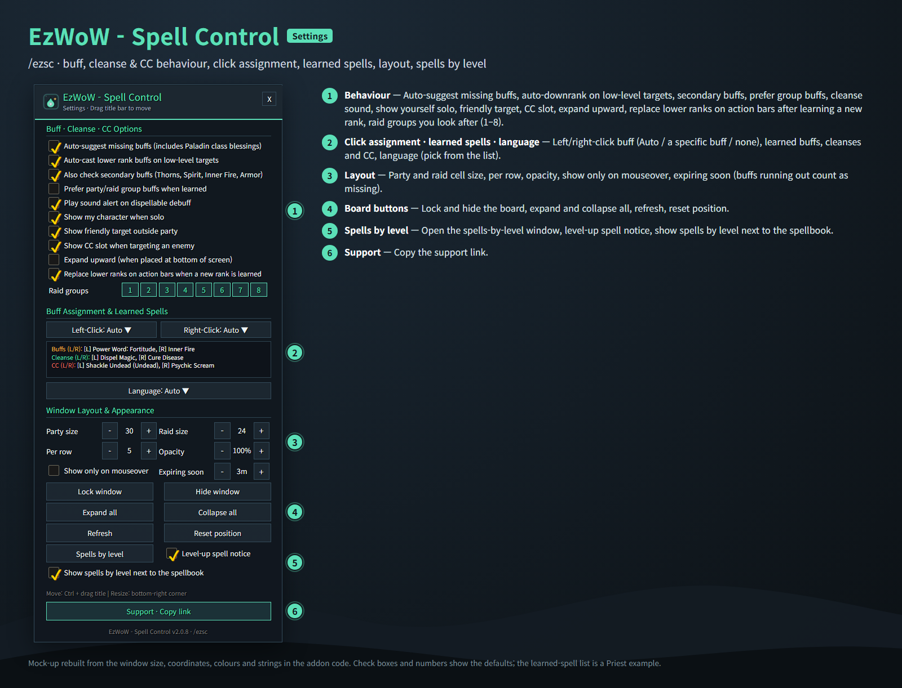
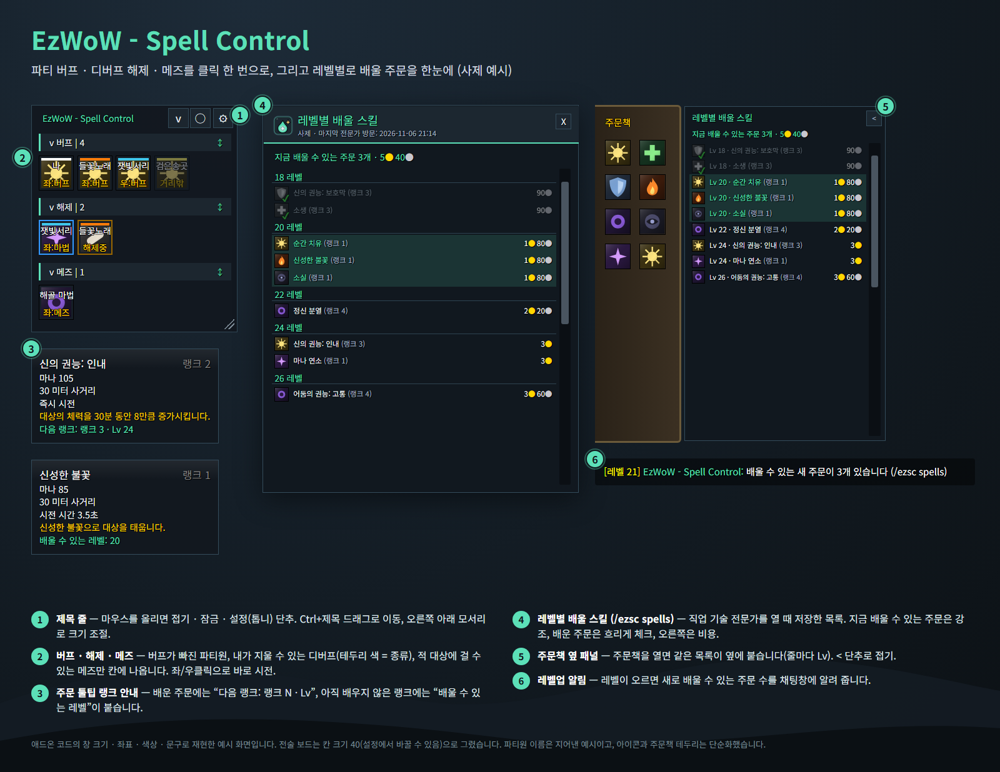
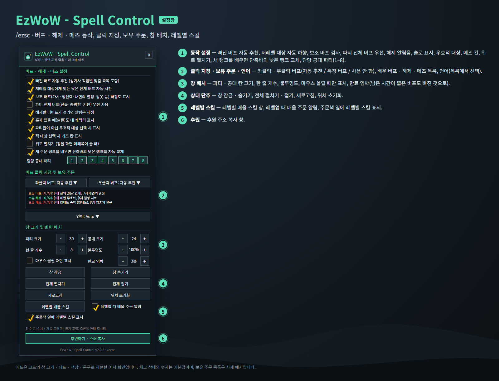

<!--
CurseForge summary (EN): One-click party buffs, debuff cleanse and enemy crowd control, plus the spells you can learn at each level with costs, rank hints in spell tooltips and a level-up notice.
-->

# EzWoW - Spell Control

**English** · [한국어](#한국어)

A small tactical board for WoW Forever: **buff missing members, cleanse debuffs and crowd-control enemies with one click**. It reads only the active spells you have learned and shows just the units that need something. It also keeps track of **the spells you can learn at each level** after you visit your class trainer.

*Mock-ups rebuilt from the window sizes, coordinates, colours and strings in the addon code (Priest example). Names are made up.*

## Features

### Tactical board
- **Buffs**: party and raid members missing a buff, yourself when solo, and a friendly target outside your group. Left-click the main buff, right-click the secondary buff, Ctrl + mouse wheel to switch the left-click buff.
- **Cleanse**: members with a debuff you can remove appear at once with a sound; the border colour shows the debuff type, and a running Abolish effect shows `Active`.
- **Crowd control**: target an enemy and the board offers the CC that works on its creature type and range (left / right / Ctrl + left-click).
- Smart choices: class-aware buffs, auto-downranking for low-level members, optional group buffs first, buffs about to expire count as missing.
- Raid groups you look after, separate party and raid cell sizes, lock, fold, reorder sections, show only on mouseover.

### Spells by level
- Saved when you open your class trainer: every spell and rank with its level and cost.
- Window with `/ezsc spells`: spells you can learn now are highlighted, learned ones are checked, with the total cost of what you can learn now.
- The same list docks next to your spellbook (can be folded or turned off).
- Spell tooltips show **Next rank: Rank N · Lv** or **Learnable at level: N**.
- On level-up, chat tells you how many new spells you can learn.
- Optional: after learning a new rank, lower ranks on your action bars are replaced.

## Commands
- `/ezsc` (`/spellcontrol`, `/스펠컨트롤`) — settings
- `/ezsc spells` — spells by level
- `/ezsc toggle` — show or hide the board
- `/ezsc lock` — lock or unlock the board
- `/ezsc reset` — reset the board position, size and section order

The board uses secure spell buttons, so its cells do not change during combat; it tidies up when combat ends.

Languages: English, 한국어, Deutsch, Français, Español, Русский, 简体中文, 繁體中文.

---

## 한국어

WoW Forever용 작은 전술 보드입니다. **빠진 버프 걸기 · 디버프 해제 · 적 대상 메즈를 클릭 한 번으로** 합니다. 마법책에서 실제로 배운 액티브 주문만 읽어 필요한 대상만 보여 줍니다. 직업 기술 전문가를 한 번 방문하면 **레벨별로 배울 주문**도 알려 줍니다.

*애드온 코드의 창 크기 · 좌표 · 색상 · 문구로 재현한 예시 화면입니다(사제 예시). 이름은 지어낸 예시입니다.*

## 기능

### 전술 보드
- **버프**: 버프가 빠진 파티 · 공격대원, 솔로일 때 나, 파티 밖 우호적 대상. 좌클릭은 주 버프, 우클릭은 보조 버프, Ctrl + 마우스 휠로 좌클릭 버프 변경.
- **해제**: 내가 지울 수 있는 디버프에 걸린 파티원이 알림음과 함께 바로 나타납니다. 테두리 색이 디버프 종류이고, 지속형 해제가 걸려 있으면 `해제중`.
- **메즈**: 적을 대상으로 잡으면 생명체 유형과 사거리에 맞는 군중 제어 주문을 배치합니다(좌 / 우 / Ctrl + 좌클릭).
- 똑똑한 선택: 직업별 맞춤 버프, 저레벨 대상 자동 하향, 단체 버프 우선(선택), 곧 끝나는 버프도 빠진 것으로 표시.
- 담당 공대 파티 선택, 파티 · 공대 칸 크기 따로, 잠금 · 접기 · 섹션 순서 변경, 마우스 올릴 때만 표시.

### 레벨별 배울 스킬
- 직업 기술 전문가를 열 때 모든 주문 · 랭크의 레벨과 비용을 저장합니다.
- `/ezsc spells` 창: 지금 배울 수 있는 주문은 강조, 배운 주문은 체크, 지금 배울 수 있는 주문의 합계 비용 표시.
- 같은 목록이 주문책 옆에 붙습니다(접거나 끌 수 있음).
- 주문 툴팁에 **다음 랭크: 랭크 N · Lv** 또는 **배울 수 있는 레벨: N** 표시.
- 레벨이 오르면 새로 배울 수 있는 주문 수를 채팅창에 알려 줍니다.
- 선택: 새 랭크를 배우면 단축바의 낮은 랭크를 자동으로 바꿉니다.

## 명령어
- `/ezsc` (`/spellcontrol`, `/스펠컨트롤`) — 설정창
- `/ezsc spells` (`/ezsc 스킬`) — 레벨별 배울 스킬
- `/ezsc toggle` — 보드 보이기/숨기기
- `/ezsc lock` — 보드 잠금/해제
- `/ezsc reset` — 보드 위치 · 크기 · 섹션 순서 초기화

보안 주문 버튼을 쓰기 때문에 전투 중에는 칸 구성이 바뀌지 않고, 전투가 끝나면 다시 정리됩니다.

지원 언어: English, 한국어, Deutsch, Français, Español, Русский, 简体中文, 繁體中文.
